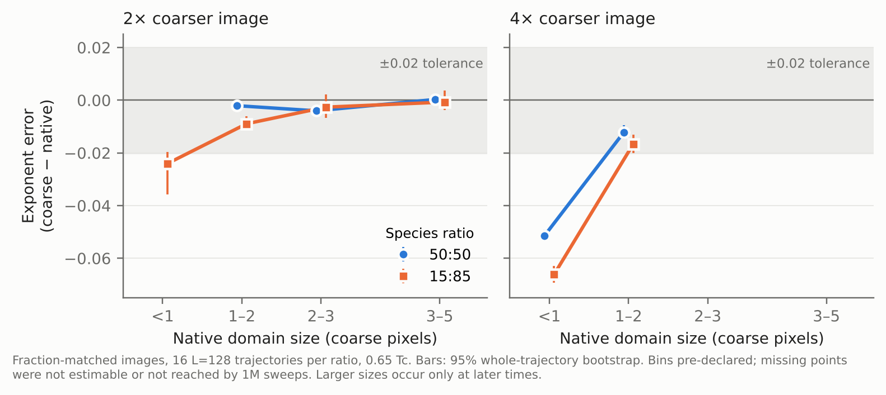

<!--
DRAFT v3, 18 October 2026, restructured by an AI assistant from the revised
brief (ACADEMIC_REVIEW_BRIEF_revised_2026-10-18.md). Same numbers, new order:
result first, one figure, caveats gathered in one box. The two [DJANGO WRITES]
blocks must be written by Django in his own words. Nothing has been sent.
-->

**Django Thompson**, gap-year student, Oxford. Draft for criticism, October 2026.

## In one page

> **[DJANGO WRITES — about 150 words, own words, no copying from below.]**
> 1. The question, in one sentence.
> 2. The result, in one sentence (use the figure).
> 3. Why it might matter to someone who images microstructures.
> 4. How I got here (from entropy and the arrow of time to this question), in two sentences at most.

**What I'd most value from you:** [DJANGO WRITES — one question tailored to the
reader, e.g. "Does this match what you see when thresholding small α′ precipitates?"]

**Who did what:** [DJANGO WRITES — one honest sentence on what you decided, ran,
checked and can explain, and what the AI built.] The code, analyses and much of
the drafting were done with substantial AI assistance; the full record is in the
repository's contribution file.

## The result

In simulated 2D phase separation (conserved Kawasaki dynamics, L=128, 0.65 Tc),
I coarsened each snapshot by block-averaging and then thresholded it back to two
phases, forcing the phase fraction to match the original exactly. I then compared
the growth exponent measured from the coarse images with the one from the native images.

- **When domains are smaller than one coarse pixel, the coarse image underestimates
  the exponent by 0.05–0.07** (roughly a fifth to a third of the native value of 0.23–0.24).
  A fresh, pre-frozen set of 16 trajectories gives −0.050 [−0.053, −0.048] at
  50:50 and −0.077 [−0.080, −0.073] at 15:85.
- **Once domains span one to two coarse pixels, the error falls by about
  three-quarters** (−0.012 [−0.015, −0.009] and −0.017 [−0.020, −0.013] at 4×).
  At 2× coarsening it stays within ±0.02 from one coarse pixel upward.
- **Matching the phase fraction makes no difference.** A plain 0.5 threshold
  gives the same shift (−0.051 / −0.076) despite about 2% fraction error. The loss
  of resolution is what matters, not the fraction.

## Why sub-pixel lengths mislead

The length is the half-height of the image's two-point correlation. At 4× in the
early window every coarse length is 0.53–0.99 coarse pixels, so the correlation
already falls below one half before the first coarse lag. The reported length is
then L = 4 × 0.5 / (1 − C(1)), set entirely by how alike neighbouring coarse pixels
are. That behaves more like an interface count than a domain size, so its time
slope need not match the true growth exponent.

## The answer depends on the measurement

On the same trajectories the mean chord length shifts much less (−0.007 at 50:50,
−0.013 at 15:85), and a one-pass majority filter moves half-height and chord slopes
in opposite directions. Un-thresholded grey block means keep the slope only while
domains are sub-pixel, and are biased (−0.046) once resolved. So "which observable"
is part of the answer, not a detail.

## Limits (all of them, in one place)

| | |
|---|---|
| Resolution vs time | Larger pixel counts occur only later, when the native exponent itself rises (0.24 → 0.33 at 50:50). Comparing 2× and 4× at the same times partly separates them. |
| Not established | Under rules declared in advance (by the AI assistant, not by me), a resolved "success regime" holds at 50:50 but is undecided at 15:85. Runs never reach 3 coarse pixels at 4×. |
| Systematic choices | Grid origin, tie rule and length definition move the shift as much as or more than the bootstrap intervals, which cover trajectory sampling only (8–16 trajectories per condition). |
| Native exponent | The native ~0.23 is the known slow approach to 1/3 in 2D spin exchange (Huse 1986; Amar, Sullivan and Mountain 1988). This study doesn't explain it. |
| Scope | 2D simulation, binary images, one temperature. Not calibrated to any alloy or microscope; the ±0.02 tolerance is a project choice. |
| Checks | A full arithmetic audit found and corrected 37 secondary lengths (no headline change); headline exponents were recomputed from raw snapshots with separately written code. Two pre-declared resolution screens had no demonstrated acceptance coverage. |

## Closest literature

Block-spin processing and multiple lengths in conserved Ising growth (Roland and
Grant 1989); threshold-dependent coarsening fits (Zabler et al. 2007); downsampling
with fraction adjustment in alloys (Werz et al. 2014); resolution-dependent
descriptors and a reduction criterion (Ledesma-Alonso et al. 2018); porosity
matching not protecting unresolved geometry (Korneev et al. 2018); mean-preserving
coarsening (Eidel et al. 2021). The possible contribution is narrower: a paired
kinetic benchmark of exponent error against pixels per domain, for several
observables. Novelty is not established.

## Questions for a specialist

1. Is a map of exponent error against pixels per domain useful, or already known?
2. At what size do you consider a length resolved, and which observable would you
   trust for kinetics?
3. Would longer or larger runs (to reach three or more coarse pixels) be worth it?

Code, raw data and audits: github.com/djangothompson12-alt/ising-monte-carlo
